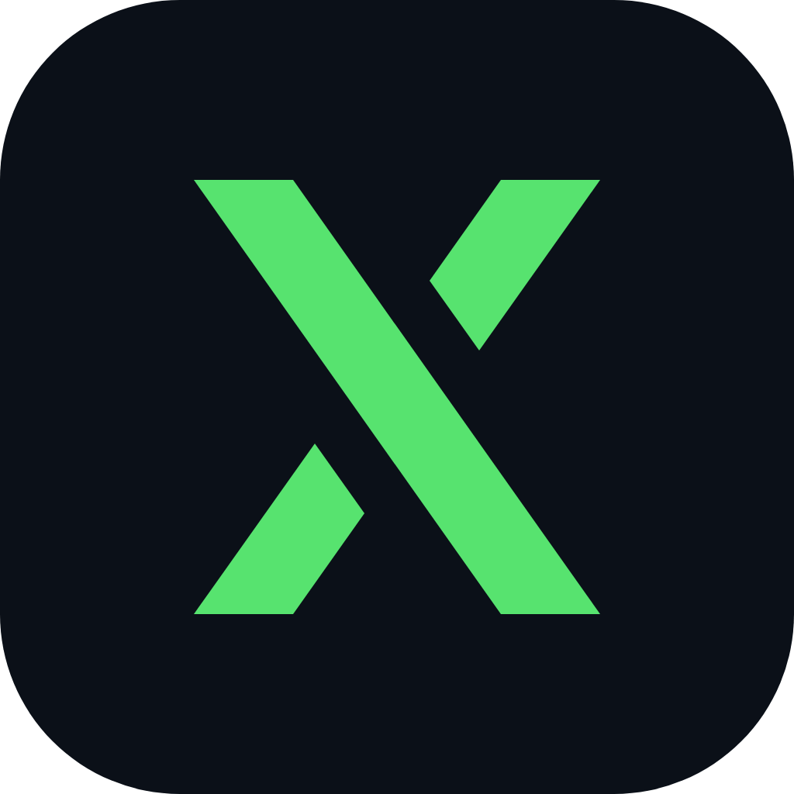
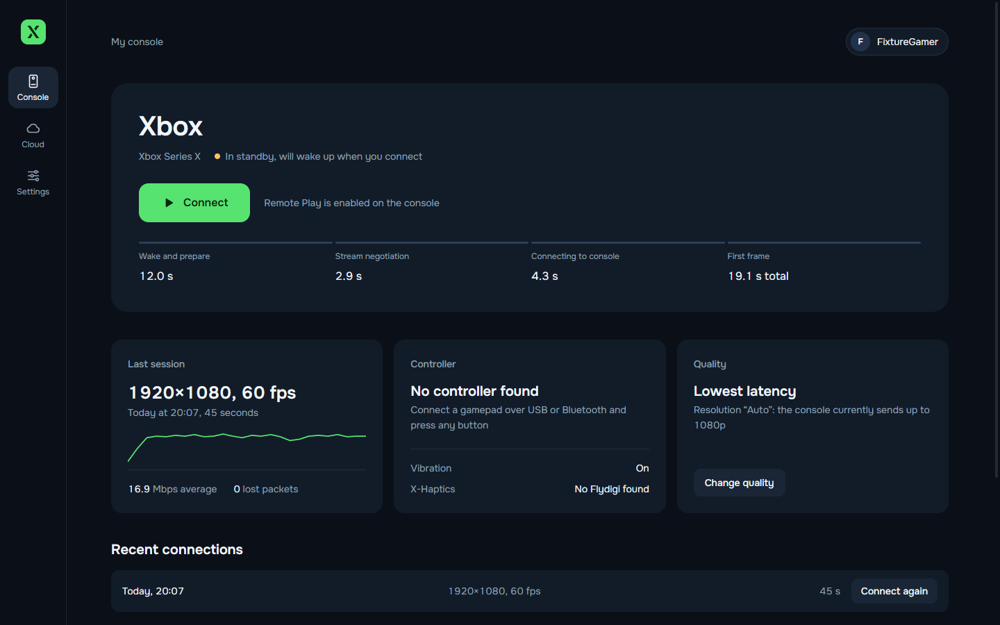
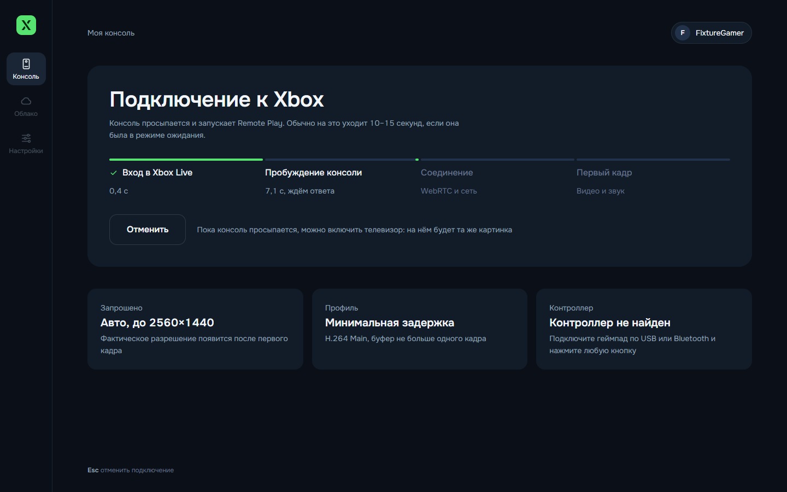
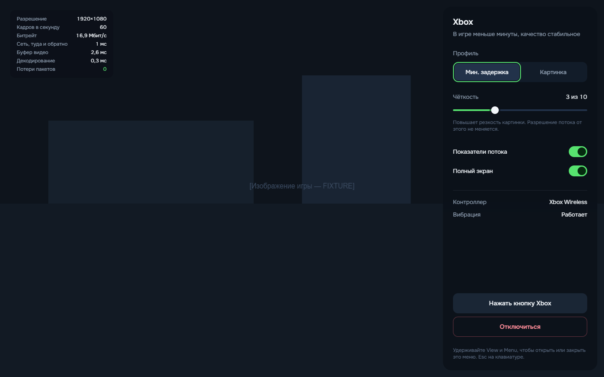
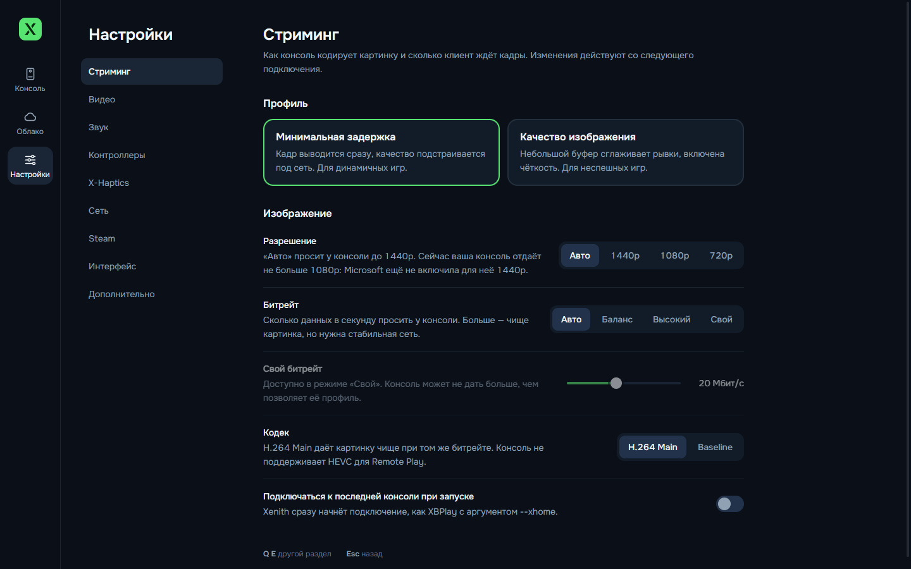
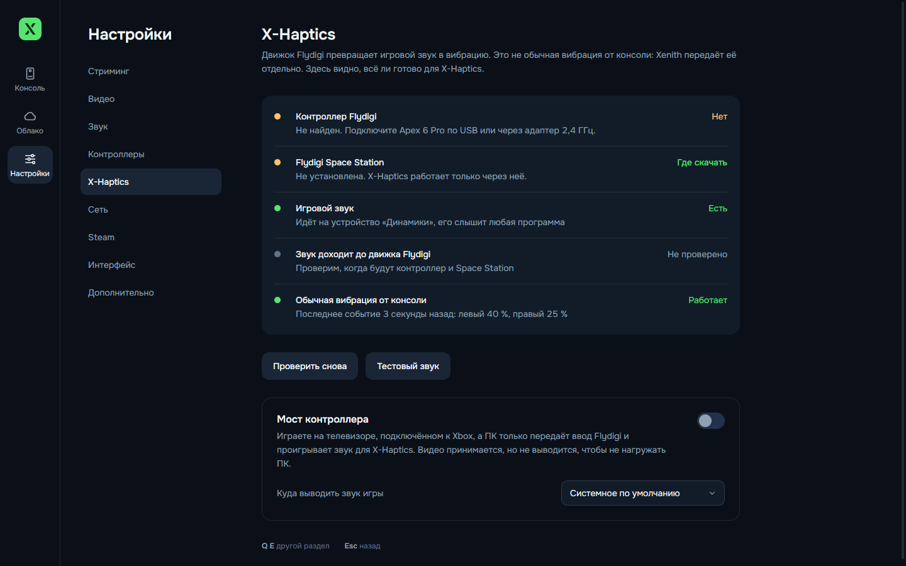
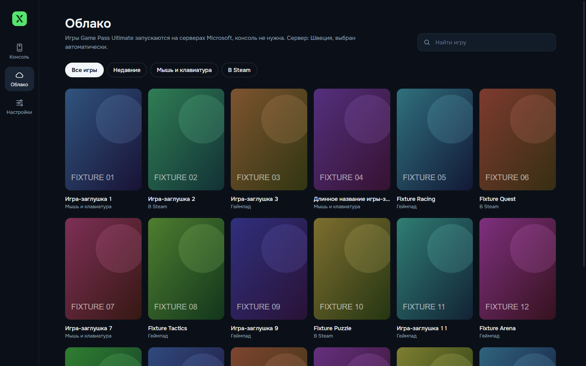
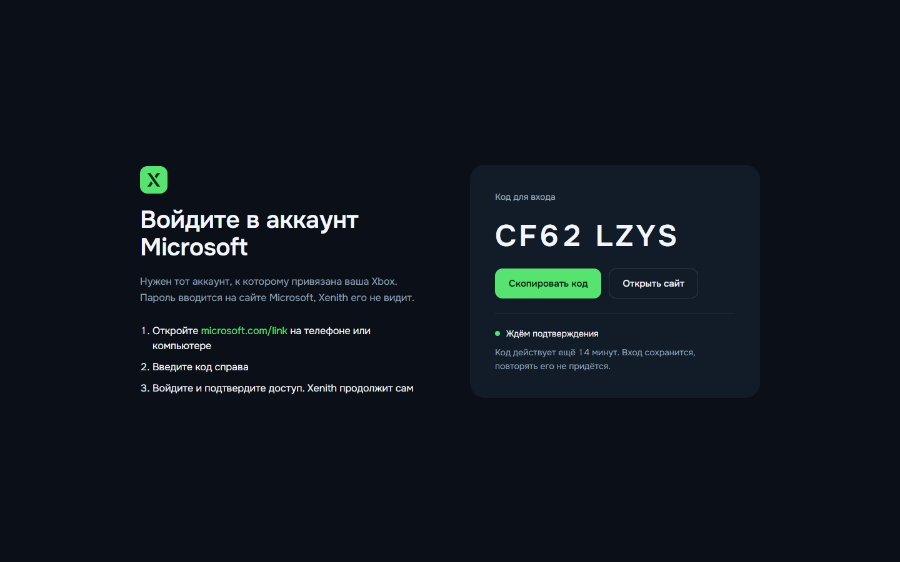
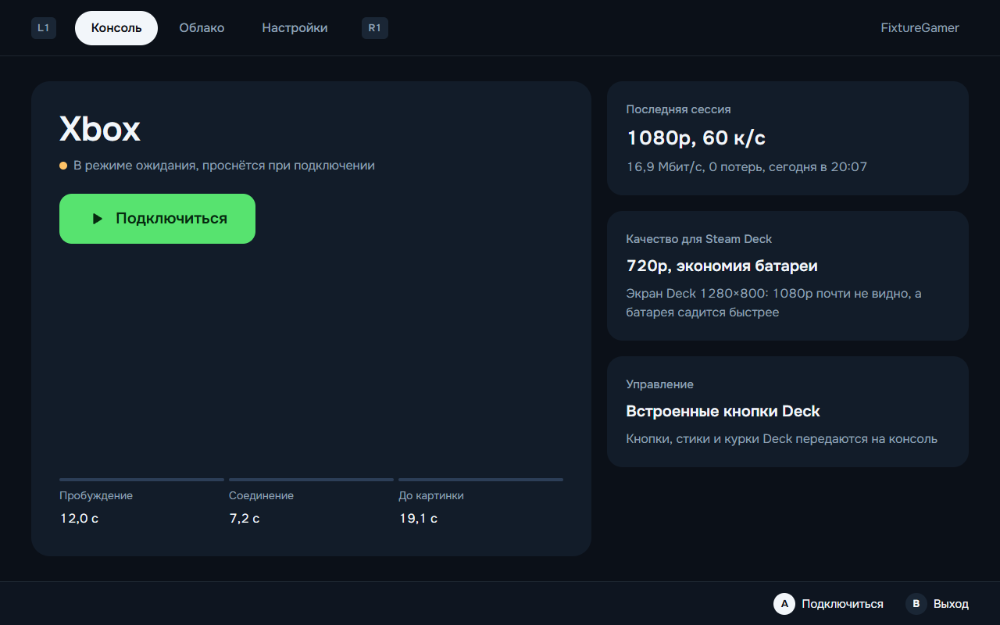
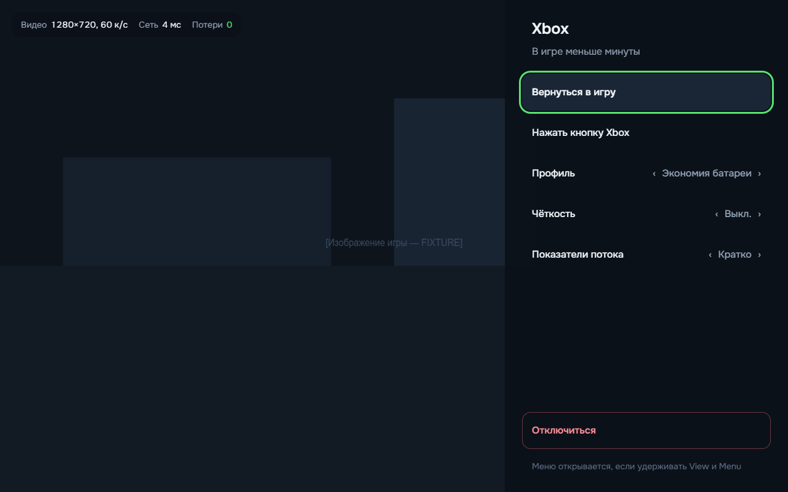

<p align="center">
  
</p>

<h1 align="center">Xenith</h1>

<p align="center">
  An open-source Xbox Remote Play and Xbox Cloud Gaming client for Windows 11 and Steam Deck.<br>
  Russian and English UI, full gamepad navigation, honest stream statistics.
</p>

<p align="center">
  <a href="README.md">Р СѓСЃСЃРєРёР№</a> В· <b>English</b>
</p>



## Features

- **Remote Play from your own Xbox.** Finds the console on your account, wakes it from standby and connects with one button. 1080p60 video, H.264 Main, about 16–18 Mbps on a local network.
- **Game Pass Ultimate cloud games.** Library with search, collections, localized names and cover art; server queue with an estimated wait.
- **Honest numbers.** The stats overlay shows the real inbound frame size, bitrate, network round trip, jitter buffer, decode time and packet loss. If the console sends 1080p, Xenith never says "1440p".
- **Profiles.** "Low latency" (about 3 ms video buffer), "Image quality" (smoothing buffer plus sharpening), "Battery saver" for Steam Deck.
- **Picture.** Sharpening (CAS), FSR 1.0 upscaling, brightness, contrast, saturation, fit modes. Everything can be turned off.
- **Controls.** Gamepad navigation everywhere. View + Menu: short press is the Xbox button, hold opens the Xenith menu. Dead zone, rumble and trigger rumble, mouse and keyboard.
- **Steam.** Adds Xenith and cloud games to your Steam library with artwork; launches from Steam Deck Gaming Mode.
- **Flydigi and X-Haptics.** Diagnostics for the controller, Flydigi Space Station and game audio, plus a "Controller bridge" mode: the Xbox drives the TV over HDMI while the PC forwards input and plays game audio for X-Haptics.
- **Reliability.** Automatic reconnect after a drop (picture back in about 9 s), tokens in the OS secure storage, no tokens in logs.

## Screenshots

The UI is shown in Russian (default); switch to English in Settings › Interface › Language.

| Connecting | In-game menu |
|---|---|
|  |  |

| Streaming settings | X-Haptics |
|---|---|
|  |  |

| Cloud | Sign in with a code |
|---|---|
|  |  |

**Steam Deck**

| Home | In-game menu |
|---|---|
|  |  |

Screenshots use demo data, so game covers are placeholders. UI mockups live in [docs/design](docs/design).

## Install

### Windows 11

1. Download `Xenith-Setup-<version>.exe` from [Releases](../../releases) (or the portable `Xenith-<version>-win-x64.zip`).
2. Run the installer. No admin rights needed; it installs for the current user.
3. The build is not code-signed yet, so SmartScreen asks once: "More info" в†’ "Run anyway".

### Steam Deck (SteamOS)

A native Linux build, no Proton. Details: [docs/platform/steam-deck.md](docs/platform/steam-deck.md).

1. In Desktop Mode download `Xenith-<version>-x86_64.AppImage` and allow it to run as a program.
2. Add it to Steam with "Add a Non-Steam Game" or Xenith's own "Add to Steam" button. Do not enable Proton for the shortcut.
3. Keep Steam Input on with the "Gamepad" template so the Deck controls appear as a standard Xbox controller.

### macOS

The build config exists (dmg and zip for Intel and Apple Silicon) and builds in GitHub Actions. It is unsigned and not yet tested on a real Mac.

## First run

1. Click "Sign in". Open [microsoft.com/link](https://www.microsoft.com/link) on your phone or computer, enter the code Xenith shows and sign in with the account your Xbox uses. The password is entered on Microsoft's site; Xenith never sees it.
2. On the Xbox enable Remote features: Settings в†’ Devices & connections в†’ Remote features.
3. Click "Connect".

## Controls while streaming

| Action | Gamepad | Keyboard and mouse |
|---|---|---|
| Xenith menu | Hold View + Menu ~0.6 s | Esc or F1; the "Menu" button appears when you move the mouse |
| Xbox button | Short press View + Menu | "Press the Xbox button" in the menu |
| Fullscreen | — | F11 or F10 |
| Disconnect | Menu в†’ "Disconnect" | Menu в†’ "Disconnect" |

## Launch arguments

| Argument | Effect |
|---|---|
| `--xhome` | Connect to the last console right away |
| `--xcloud=<titleId>` | Start a cloud game right away (used by cloud game shortcuts in Steam) |

## Measured on real hardware

Xbox Series X on a local network, PC with a Radeon RX 9070 XT. Full log: [docs/TESTLOG.md](docs/TESTLOG.md).

| Metric | Value |
|---|---|
| Resolution and frame rate | 1920Г—1080, 60 fps |
| Codec | H.264 Main 4.2 (the console offers no High profile and no HEVC) |
| Bitrate | 16–18 Mbps |
| Decode | 0.3–0.4 ms per frame, hardware |
| Video buffer | 2.6–2.8 ms ("Low latency"), ~23 ms ("Image quality") |
| Connect to first frame | 7–10 s (console on), ~19 s (from standby) |
| Reconnect after a drop | ~9 s |
| 10-minute session | 0 packets lost, flat memory |

## Known limits

- **1440p.** Microsoft is testing 1440p Remote Play with some Insiders only. On our console even the official client gets 1080p. Xenith already requests 1440p the same way the official client does and will get it once Microsoft enables the preview.
- **Bitrate above ~18 Mbps** is not possible: the console ignores requests to raise it. Lowering the bitrate works.
- **Cloud over a VPN.** If cloud traffic goes into a VPN tunnel, the connection may come up without video. Exclude Xenith or the Xbox Cloud servers from the tunnel.
- **Flydigi Apex 6 Pro and X-Haptics** are not yet tested with a real controller.
- **Steam Deck**: the build and VA-API are verified only against documentation and tests, not on a real Deck.

## Build from source

Requires Node.js 22+ and Git.

```bash
npm install
node build.mjs          # main, preload and UI в†’ dist/
npx electron .          # run
npx tsc --noEmit        # type check
npx electron-builder --win nsis zip     # Windows installer
```

Tests:

```bash
node tools/core-test/run.mjs            # core: settings, history, sessions, ICE
node tools/platform-test/run-tests.mjs  # Steam VDF, appid, Deck, Flydigi
node tools/stream-test/run-input-test.mjs  # input: combos, Guide, rumble
```

Linux and macOS build in GitHub Actions: [.github/workflows/build.yml](.github/workflows/build.yml).

## Architecture

- **Electron** (Chromium WebRTC): hardware decode and gamepads out of the box, one codebase for Windows, SteamOS and macOS. Why not Tauri or a native client: [docs/adr/0001-stack-electron.md](docs/adr/0001-stack-electron.md).
- `src/main` — Microsoft and Xbox Live sign-in, xHome and xCloud session REST APIs, Game Pass catalog, settings, history, logs.
- `src/main/platform` — GPU modes, VA-API, Steam Deck detection, Steam shortcuts, Flydigi diagnostics.
- `src/renderer` — React UI, gamepad navigation, Russian and English.
- `src/renderer/stream` — streaming engine: WebRTC, stats, profiles, sharpening, input, reconnect.
- `src/shared` — the shared contract between the parts.

## Credits and license

Xenith is MIT-licensed. Protocol knowledge comes from MIT-licensed open-source projects:
[Greenlight](https://github.com/unknownskl/greenlight) and [xbox-xcloud-player](https://github.com/unknownskl/xbox-xcloud-player) (unknownskl),
[XStreaming-desktop](https://github.com/Geocld/XStreaming-desktop) and [xstreaming-player](https://github.com/Geocld/XStreaming-player) (Geocld; the player is vendored in `vendor/` with our fixes),
[better-xcloud](https://github.com/redphx/better-xcloud) (redphx).

Xenith is not affiliated with Microsoft or Xbox. Xbox is a trademark of Microsoft.
