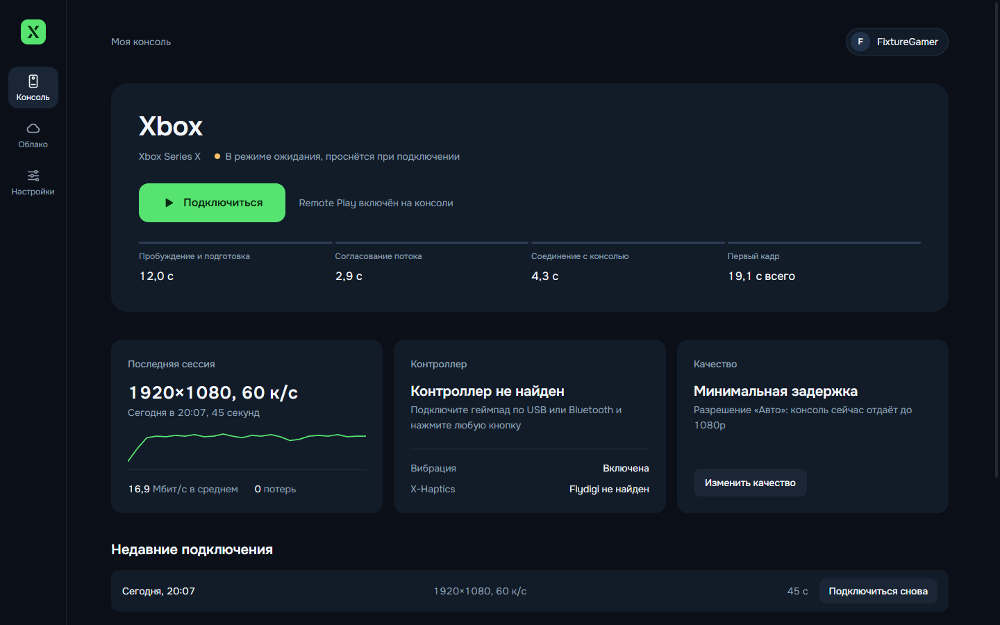

<p align="center">
  
</p>

<h1 align="center">Xenith</h1>

<p align="center">
  Открытый клиент Xbox Remote Play и Xbox Cloud Gaming для Windows 11 и Steam Deck.<br>
  Русский и английский интерфейс, управление геймпадом, честная статистика потока.
</p>

<p align="center">
  <b>Русский</b> · <a href="README.en.md">English</a>
</p>



## Что умеет

- **Remote Play со своей Xbox.** Находит консоль в аккаунте, будит её из режима ожидания и подключается одной кнопкой. Видео 1080p60, H.264 Main, около 16–18 Мбит/с по локальной сети.
- **Облачные игры Game Pass Ultimate.** Библиотека с поиском, подборками, русскими названиями и обложками, очередь на сервер с оценкой времени.
- **Честные цифры.** Счётчик показывает реальное разрешение входящего кадра, битрейт, задержку сети, буфер, время декодирования и потери. Если консоль отдаёт 1080p, Xenith не напишет «1440p».
- **Профили.** «Минимальная задержка» (буфер видео около 3 мс), «Качество изображения» (сглаживающий буфер и чёткость), «Экономия батареи» для Steam Deck.
- **Картинка.** Повышение чёткости (CAS), масштабирование FSR 1.0, яркость, контраст, насыщенность, режимы заполнения экрана. Всё отключается.
- **Управление.** Навигация геймпадом по всему приложению. View + Menu: короткое нажатие — кнопка Xbox, удержание — меню Xenith. Мёртвая зона, вибрация и вибрация курков, мышь и клавиатура.
- **Steam.** Ярлык Xenith и ярлыки облачных игр в библиотеке Steam с обложками, запуск из игрового режима Steam Deck.
- **Flydigi и X-Haptics.** Диагностика контроллера, Flydigi Space Station и игрового звука, режим «Мост контроллера»: картинка на телевизоре от Xbox, а ПК передаёт ввод и звук для X-Haptics.
- **Надёжность.** Автоматическое переподключение после обрыва (картинка возвращается примерно за 9 секунд), токены в защищённом хранилище ОС, никаких токенов в логах.

## Скриншоты

| Подключение | Во время игры |
|---|---|
|  |  |

| Настройки стриминга | X-Haptics |
|---|---|
|  |  |

| Облако | Вход по коду |
|---|---|
|  |  |

**Steam Deck**

| Главный экран | Меню во время игры |
|---|---|
|  |  |

Скриншоты сделаны на демонстрационных данных, поэтому вместо обложек игр — заглушки. Макеты интерфейса лежат в [docs/design](docs/design).

## Установка

### Windows 11

1. Скачайте `Xenith-Setup-<версия>.exe` со страницы [Releases](../../releases) (или портативный `Xenith-<версия>-win-x64.zip`).
2. Запустите установщик. Права администратора не нужны, приложение ставится для текущего пользователя.
3. Сборка пока не подписана, поэтому Windows SmartScreen один раз спросит: «Подробнее» → «Выполнить в любом случае».

### Steam Deck (SteamOS)

Нативная Linux-сборка, без Proton. Подробно: [docs/platform/steam-deck.md](docs/platform/steam-deck.md).

1. В режиме рабочего стола скачайте `Xenith-<версия>-x86_64.AppImage`, в свойствах файла разрешите запуск.
2. Добавьте его в Steam: «Добавить стороннюю игру» или кнопкой «Добавить в Steam» в настройках Xenith. Proton для ярлыка не включайте.
3. Steam Input оставьте включённым с шаблоном «Геймпад»: тогда кнопки Deck видны как обычный Xbox-контроллер.

### macOS

Конфигурация сборки есть (dmg и zip для Intel и Apple Silicon), собирается в GitHub Actions. Сборка не подписана и пока не проверялась на реальном Mac.

## Первый запуск

1. Нажмите «Войти». Откройте [microsoft.com/link](https://www.microsoft.com/link) на телефоне или компьютере, введите код из Xenith и войдите в аккаунт, к которому привязана Xbox. Пароль вводится на сайте Microsoft, Xenith его не видит.
2. На Xbox включите удалённые функции: «Настройки» → «Устройства и подключения» → «Удалённые функции».
3. Нажмите «Подключиться».

## Управление во время игры

| Действие | Геймпад | Клавиатура и мышь |
|---|---|---|
| Меню Xenith | Удерживать View + Menu ~0,6 с | Esc или F1, кнопка «Меню» в углу при движении мыши |
| Кнопка Xbox | Коротко нажать View + Menu | «Нажать кнопку Xbox» в меню |
| Полный экран | — | F11 или F10 |
| Отключиться | Меню → «Отключиться» | Меню → «Отключиться» |

## Аргументы запуска

| Аргумент | Что делает |
|---|---|
| `--xhome` | Сразу подключиться к последней консоли |
| `--xcloud=<titleId>` | Сразу запустить облачную игру (так работают ярлыки облачных игр в Steam) |

## Что измерено на реальном оборудовании

Xbox Series X в локальной сети, ПК с Radeon RX 9070 XT. Полный журнал: [docs/TESTLOG.md](docs/TESTLOG.md).

| Показатель | Значение |
|---|---|
| Разрешение и частота | 1920×1080, 60 к/с |
| Кодек | H.264 Main 4.2 (консоль не предлагает High и HEVC) |
| Битрейт | 16–18 Мбит/с |
| Декодирование | 0,3–0,4 мс на кадр, аппаратное |
| Буфер видео | 2,6–2,8 мс («Минимальная задержка»), ~23 мс («Качество») |
| От «Подключиться» до картинки | 7–10 с (консоль включена), ~19 с (из режима ожидания) |
| Переподключение после обрыва | ~9 с |
| 10 минут стрима | 0 потерь, память стабильна |

## Честные ограничения

- **1440p.** Microsoft тестирует Remote Play в 1440p только для части инсайдеров. На нашей консоли даже официальный клиент получает 1080p. Xenith уже запрашивает 1440p так же, как официальный клиент, и получит его, когда Microsoft включит превью.
- **Битрейт выше ~18 Мбит/с** консоль не даёт: запросы на повышение она игнорирует. Ограничение битрейта вниз работает.
- **Облако через VPN.** Если облачный трафик уходит в VPN-туннель, соединение может устанавливаться без видео. Исключите Xenith или серверы Xbox Cloud из туннеля.
- **Flydigi Apex 6 Pro и X-Haptics** пока не проверены с реальным контроллером.
- **Steam Deck**: запуск из игрового режима проверен на Steam Deck OLED; стрим и VA-API на Deck ещё не измерены. Ярлык из Steam запускает Xenith через `~/.local/share/xenith/steam-launch.sh` (обход ошибки GPU-процесса Chromium при запуске клиентом Steam).

## Сборка из исходников

Нужны Node.js 22+ и Git.

```bash
npm install
node build.mjs          # main, preload и интерфейс → dist/
npx electron .          # запуск
npx tsc --noEmit        # проверка типов
npx electron-builder --win nsis zip     # установщик Windows
```

Тесты:

```bash
node tools/core-test/run.mjs            # ядро: настройки, история, сессии, ICE
node tools/platform-test/run-tests.mjs  # Steam VDF, appid, Deck, Flydigi
node tools/stream-test/run-input-test.mjs  # ввод: комбинации, Guide, вибрация
```

Linux и macOS собираются в GitHub Actions: [.github/workflows/build.yml](.github/workflows/build.yml).

## Как устроено

- **Electron** (Chromium WebRTC): аппаратное декодирование и геймпады из коробки, одна кодовая база для Windows, SteamOS и macOS. Почему не Tauri и не нативный клиент: [docs/adr/0001-stack-electron.md](docs/adr/0001-stack-electron.md).
- `src/main` — вход в Microsoft и Xbox Live, REST-API сессий xHome и xCloud, каталог Game Pass, настройки, история, журналы.
- `src/main/platform` — режимы GPU, VA-API, Steam Deck, ярлыки Steam, диагностика Flydigi.
- `src/renderer` — интерфейс на React, навигация геймпадом, русский и английский.
- `src/renderer/stream` — стрим-движок: WebRTC, статистика, профили, чёткость, ввод, переподключение.
- `src/shared` — общий контракт между частями.

## Благодарности и лицензия

Xenith распространяется под лицензией MIT. Знания о протоколе взяты из открытых проектов под MIT:
[Greenlight](https://github.com/unknownskl/greenlight) и [xbox-xcloud-player](https://github.com/unknownskl/xbox-xcloud-player) (unknownskl),
[XStreaming-desktop](https://github.com/Geocld/XStreaming-desktop) и [xstreaming-player](https://github.com/Geocld/XStreaming-player) (Geocld; плеер включён в `vendor/` с нашими исправлениями),
[better-xcloud](https://github.com/redphx/better-xcloud) (redphx).

Xenith не связан с Microsoft и Xbox. Xbox — торговая марка Microsoft.
