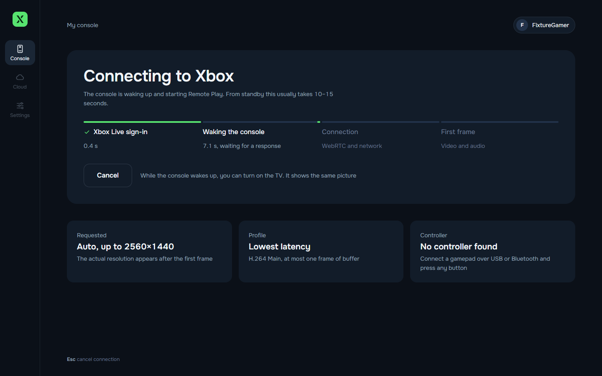
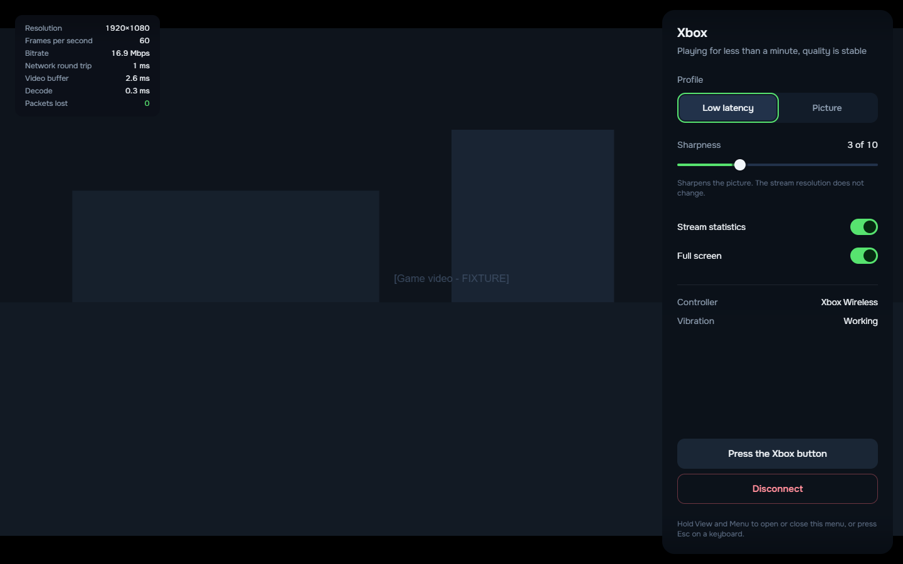
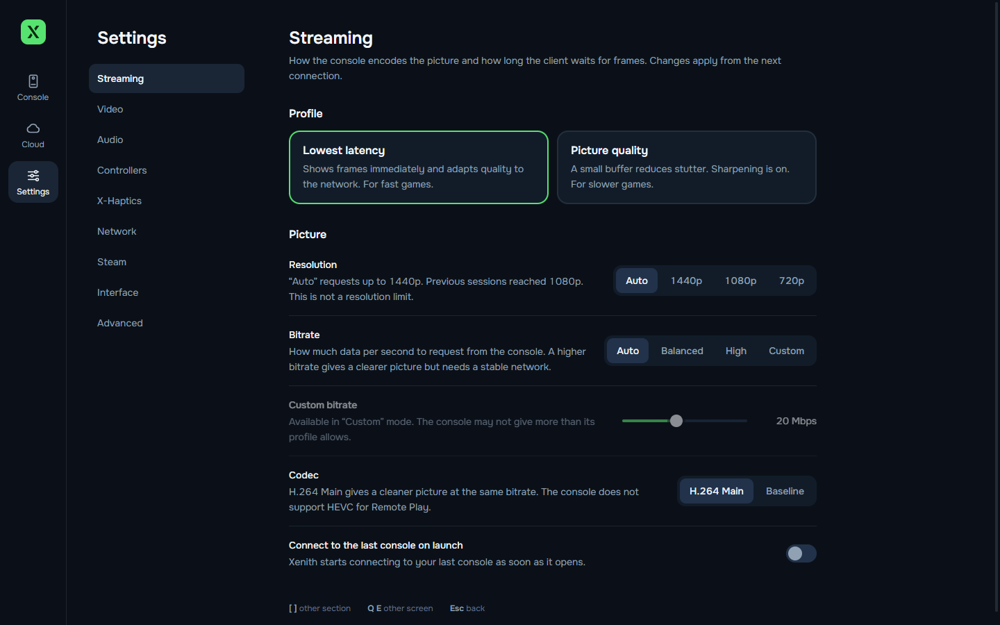
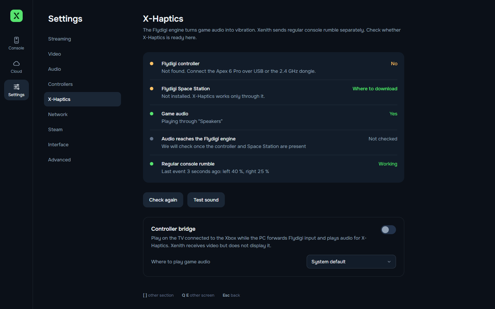
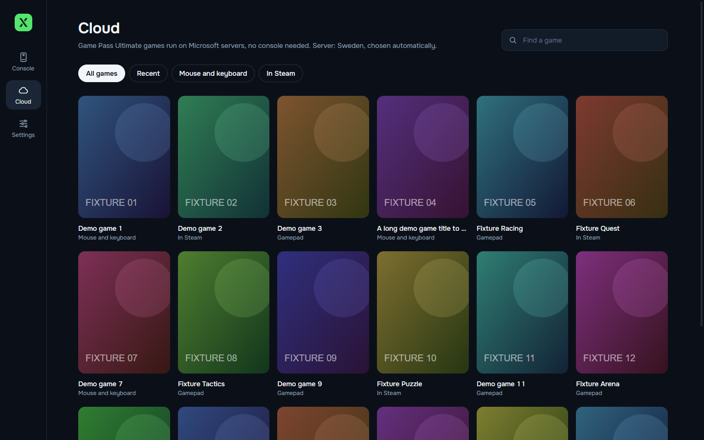
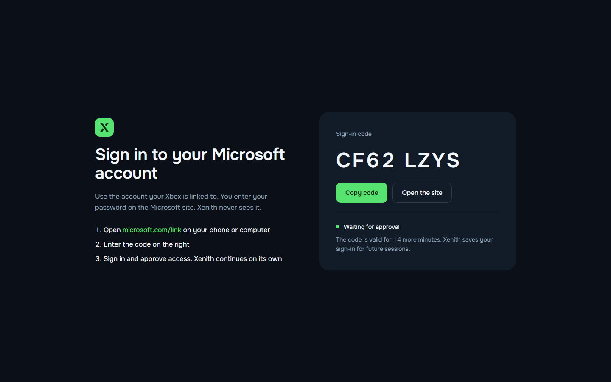
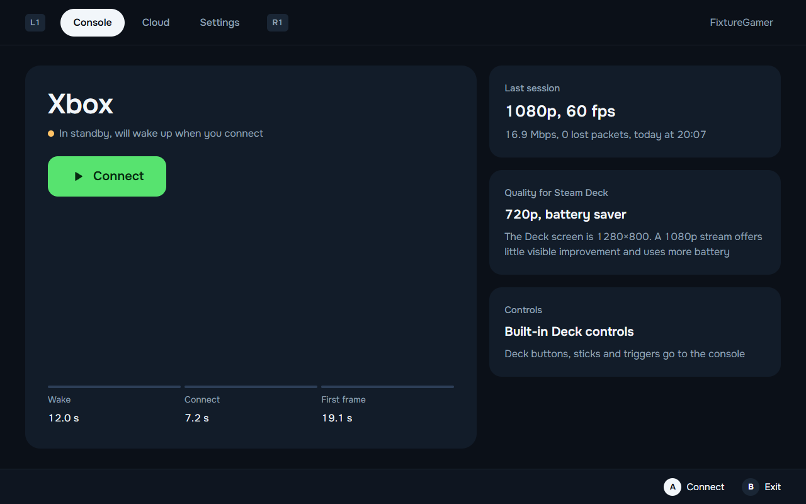
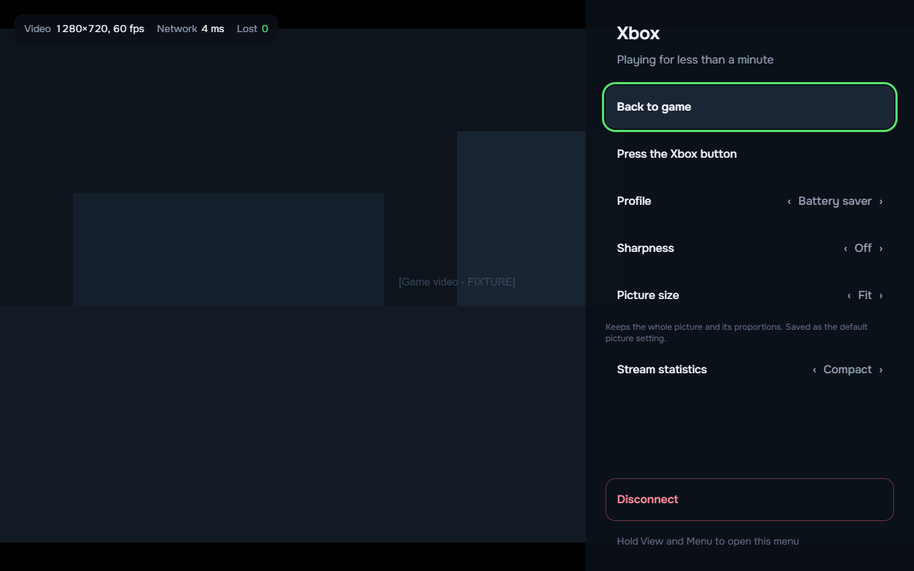
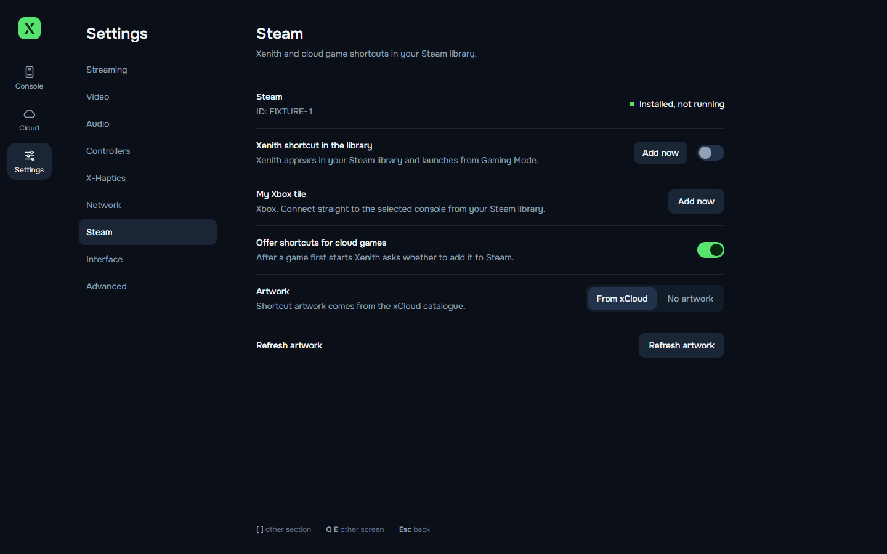
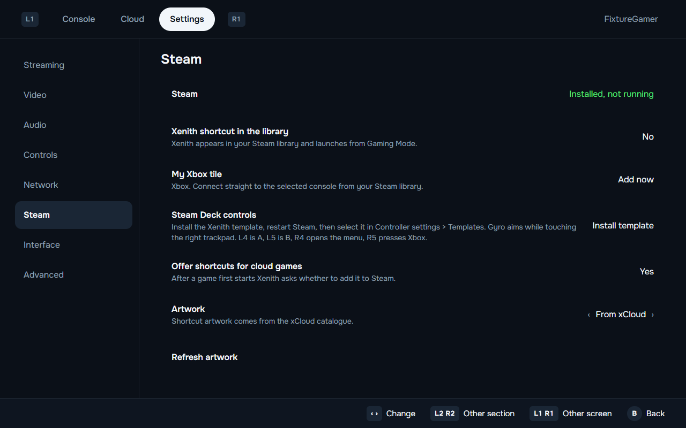

<p align="center">
  
</p>

<h1 align="center">Xenith</h1>

<p align="center">
  An open-source Xbox Remote Play and Xbox Cloud Gaming client for Windows 11 and Steam Deck.<br>
  English and Russian interfaces, gamepad navigation, and measured stream statistics.
</p>

<p align="center">
  <b>English</b> · <a href="README.ru.md">Русский</a>
</p>


## Features

- Remote Play from your Xbox at up to 1440p. Find a console linked to your account, wake it from standby, and connect. Choose Auto, 1440p, 1080p, or 720p in the streaming settings.
- Xbox Cloud Gaming. Browse and search the Game Pass Ultimate catalogue, view cover art, and see queue estimates when servers are busy.
- Stream statistics. See the received resolution, bitrate, network round-trip time, video buffer, decode time, and packet loss.
- Streaming profiles. Choose "Lowest latency", "Picture quality", or "Battery saver".
- Picture controls. Adjust CAS sharpening, FSR 1.0 upscaling, brightness, contrast, saturation, and how the video fits the window.
- Gamepad navigation. Use a gamepad throughout the app. Tap View + Menu for the Xbox button or hold them to open the Xenith menu. Configure stick dead zones, rumble, and trigger rumble.
- Steam integration. Add Xenith and cloud game shortcuts to your Steam library with artwork.
- Flydigi and X-Haptics diagnostics. Check the controller, Flydigi Space Station, and game audio. Controller bridge mode hides video on the PC while forwarding input and playing audio for X-Haptics. The Xbox supplies the TV picture over HDMI.
- Automatic reconnection. A local hardware test restored video about nine seconds after a dropped connection.

## Screenshots

New installations use English. Select a language in Settings > Interface > Language. Existing installations keep their saved choice. All screenshots on this page show the English interface.

| Connecting | In-game menu |
|---|---|
|  |  |

| Streaming settings | X-Haptics |
|---|---|
|  |  |

| Cloud games | Sign in with a code |
|---|---|
|  |  |

| Steam Deck home | Steam Deck in-game menu |
|---|---|
|  |  |

| Steam integration | Steam integration on Deck |
|---|---|
|  |  |

Screenshots use demo data and placeholder game covers. Interface mockups are in [docs/design](docs/design).

## Installation

### Windows 11

1. Download `Xenith-Setup-<version>.exe` from [Releases](https://github.com/kirtarget/xenith/releases). A portable `Xenith-<version>-win-x64.zip` is also supported by the build configuration.
2. Run the installer. It installs for the current user without administrator rights.
3. The builds are unsigned. If Windows SmartScreen blocks the installer, select "More info", then "Run anyway".

### Steam Deck and SteamOS

Xenith has a native Linux build. See the [Steam Deck notes](docs/platform/steam-deck.md) for setup details and troubleshooting.

1. In Desktop Mode, download `Xenith-<version>-linux-x64.AppImage` and allow it to run as a program in its file properties.
2. Add it to Steam with "Add a Non-Steam Game" or the "Add now" button in Xenith's Steam settings. Leave Proton disabled for the shortcut.
3. Keep Steam Input enabled with the "Gamepad" template so the Deck controls appear as an Xbox controller.

The launcher reached the sign-in screen on a Steam Deck OLED. A later fix for an endless Gaming Mode loading screen still needs a hardware retest. Streaming and VA-API performance on the Deck have not been measured.

### macOS

The build configuration and GitHub Actions workflow include DMG and ZIP packages for Intel and Apple Silicon. The builds are unsigned and have not been tested on a real Mac.

## First run

1. Select "Sign in". Open [microsoft.com/link](https://www.microsoft.com/link) on your phone or computer, enter the code shown by Xenith, and sign in with the account linked to your Xbox. Enter your password only on Microsoft's website. Xenith does not receive it.
2. On the Xbox, enable Settings > Devices & connections > Remote features.
3. Select "Connect".

Tokens use the operating system's secure storage on Windows and macOS. SteamOS and Linux without a working keyring use encrypted local files with a key protected by file permissions. See [secure-store.ts](src/main/secure-store.ts) for the storage implementation.

## Controls while streaming

| Action | Gamepad | Keyboard and mouse |
|---|---|---|
| Open the Xenith menu | Hold View + Menu for about 0.6 seconds | Esc or F1, or select "Menu" after moving the mouse |
| Press the Xbox button | Tap View + Menu together | F2 or "Press the Xbox button" in the menu |
| Toggle full screen | Use the session menu | F11 or F10 |
| Disconnect | Select "Disconnect" in the menu | Select "Disconnect" in the menu |

## Launch arguments

| Argument | Effect |
|---|---|
| `--xhome` | Connect to the last used console, or the first available console |
| `--xhome=<serverId>` | Connect to a specific console |
| `--xcloud=<titleId>` | Start a cloud game, as used by cloud game shortcuts in Steam |

## Steam Deck integration

### My Xbox tile

Sign in and select a console on the home screen. Open Settings > Steam and select "Add now" beside "My Xbox tile". Restart Steam to see the tile. It connects directly to that console with `--xhome=<serverId>`. You can add a separate tile for each console. Adding the same console again updates its existing shortcut.

### Gyro and back buttons

In Settings > Steam, select "Install template" beside "Steam Deck controls". Restart Steam. Open the controller settings for the Xenith or Xbox shortcut, select the current layout, open Templates, and apply "Xenith - Gyro and back buttons". Installation adds a template without replacing your selected layout.

| Control | Action |
|---|---|
| Gyro while the left trigger is pulled | Aim using the right stick |
| L4 / R4 | Left / right stick click |
| L5 / R5 | Xbox X / Y |
| Right trackpad | Mouse; click is the left mouse button |
| Left trackpad click | Right mouse button |

The Xenith menu stays on View + Menu (hold) and the Xbox button on View + Menu (short press).

Adjust gyro sensitivity and activation in Steam Input. The gyro emulates a stick, so the game's stick sensitivity and dead zone affect aiming. Separate cloud game shortcuts can use separate Steam layouts. Remote Play does not automatically identify the game running on the console.

### Sleep and reconnect

When the Deck sleeps during a session, Xenith remembers the console or cloud title and stops local streaming. After waking, it waits for network connectivity and attempts to reconnect to the same target. Disconnecting or signing out cancels pending recovery.

Sleeping the Deck does not guarantee that the remote game pauses. A cloud session may expire, and reconnecting may start a new session or queue.

### Search keyboard

In Gaming Mode, focusing the cloud search field or pressing Y requests Steam's on-screen keyboard. If it does not appear, press Steam + X. This integration applies to Xenith's search field; it does not automatically detect text fields inside a streamed game.

### Picture size on the Deck screen

Xbox video uses 16:9, while the Deck screen is 16:10. Open the Xenith menu during streaming and change "Picture size" with left/right or A. Changes apply immediately, including with CAS sharpening or FSR upscaling.

| Mode | Result on a 1280 x 800 Deck screen |
|---|---|
| Fit | Keeps the whole frame and its proportions, with 40-pixel bars above and below a 16:9 stream |
| Fill | Fills the screen and crops about 5% from each side; game interface elements near the edges may be lost |
| Stretch | Fills the screen without cropping by stretching the picture vertically by about 11% |

Fit is the default. Xenith remembers the selected mode separately for each cloud game and restores it on the next connection. Other games keep their own choices. For Remote Play, this control changes the global picture setting. These modes do not change the stream resolution or create a wider field of view.

The shortcut and recovery logic have automated checks. Template selection, gyro feel, keyboard visibility, and recovery after actual Deck sleep still need verification on hardware.

## Hardware measurements

These measurements used an Xbox Series X on a local network and a PC with a Radeon RX 9070 XT on October 22, 2026. They describe that setup. See the [test log](docs/TESTLOG.md) for methods and remaining checks.

| Metric | Recorded value |
|---|---|
| Resolution and frame rate | 1920 x 1080 at 60 fps |
| Codec | H.264 Main 4.2 |
| Bitrate | About 16 to 18 Mbps |
| Decode time | 0.3 to 0.4 ms per frame; hardware decoding inferred from GPU activity |
| Video buffer | About 2.6 to 2.8 ms with "Lowest latency", about 23 ms with "Picture quality" |
| Connection to first frame | About 7 to 10 seconds with the console on, about 19 seconds from standby |
| Reconnection after a drop | About nine seconds |
| 594-second sample | No packet loss or dropped frames; stable memory usage |

A keepalive issue ended the 594-second run. The fix passed a shorter integrated session, but the full ten-minute test has not been repeated.

## Known limitations

- Xenith supports 1440p streaming. The hardware measurements above used a 1080p stream and do not describe the app's maximum resolution. Stream statistics show the resolution actually received.
- The tested console ignored requests for bitrates above about 18 Mbps. Lower bitrate limits worked.
- Cloud traffic routed through a VPN may connect without video. Excluding Xenith or the Xbox Cloud servers from the tunnel may help.
- Flydigi Apex 6 Pro and X-Haptics still need testing with a physical controller.
- Steam Deck Gaming Mode and macOS require the follow-up checks described above.

## Build from source

Install Node.js 22 or later and Git. The CI workflow uses Node.js 24.

```bash
npm ci
npm run typecheck
npm run build
npx electron .
```

Create a Windows installer and portable ZIP after building the app.

```bash
npx electron-builder --win nsis zip --publish never
```

The [CI workflow](.github/workflows/build.yml) also defines Linux and macOS builds. Packaging requires a suitable host for the target operating system.

Run the automated checks.

```bash
node tools/core-test/run.mjs
node tools/platform-test/run-tests.mjs
node tools/stream-test/run-input-test.mjs
```

On a desktop session, verify Steam shortcut files, artwork, and template installation in an isolated temporary Steam directory. This does not modify your Steam library.

```bash
node tools/platform-test/run-steam-smoke.mjs
```

Check live Fit/Fill/Stretch changes with the real FSR WebGL pipeline and a generated local video source.

```bash
node tools/ui-preview/check-fsr.mjs
```

Preview and check the English interface on desktop and Steam Deck layouts with fixture data.

```bash
node tools/ui-preview/build.mjs
npx electron tools/ui-preview/capture.cjs --lang=en --check --sizes=1440x900,deck
```

## Architecture

Xenith uses Electron, Chromium WebRTC, and React. See the [stack decision](docs/adr/0001-stack-electron.md) for the reasoning.

| Directory | Responsibility |
|---|---|
| `src/main` | Microsoft and Xbox Live sign-in, Remote Play and cloud session APIs, game catalogue, settings, history, and logs |
| `src/main/platform` | GPU configuration, VA-API, Steam Deck detection, Steam shortcuts, and Flydigi diagnostics |
| `src/renderer` | React interface, gamepad navigation, and English and Russian translations |
| `src/renderer/stream` | WebRTC streaming, statistics, profiles, picture processing, input, and reconnection |
| `src/shared` | Shared types and contracts |

## Contributing

Project changes must include matching README updates. Keep [AGENTS.md](AGENTS.md) and [CLAUDE.md](CLAUDE.md) identical. CI checks their contents with `node tools/check-agent-docs.mjs`.

## Credits and licence

Xenith uses the [MIT licence](LICENSE). Its protocol implementation draws on these MIT-licensed projects.

- [Greenlight](https://github.com/unknownskl/greenlight) and [xbox-xcloud-player](https://github.com/unknownskl/xbox-xcloud-player) by unknownskl.
- [XStreaming-desktop](https://github.com/Geocld/XStreaming-desktop) and [xstreaming-player](https://github.com/Geocld/XStreaming-player) by Geocld. The player is included in `vendor/` with local fixes.
- [better-xcloud](https://github.com/redphx/better-xcloud) by redphx.

Xenith is not affiliated with Microsoft or Xbox. Xbox is a trademark of Microsoft.
