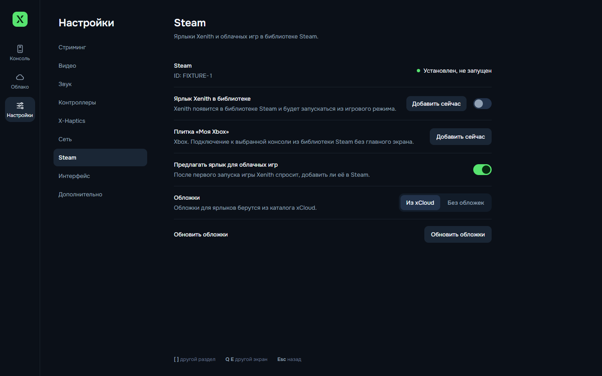
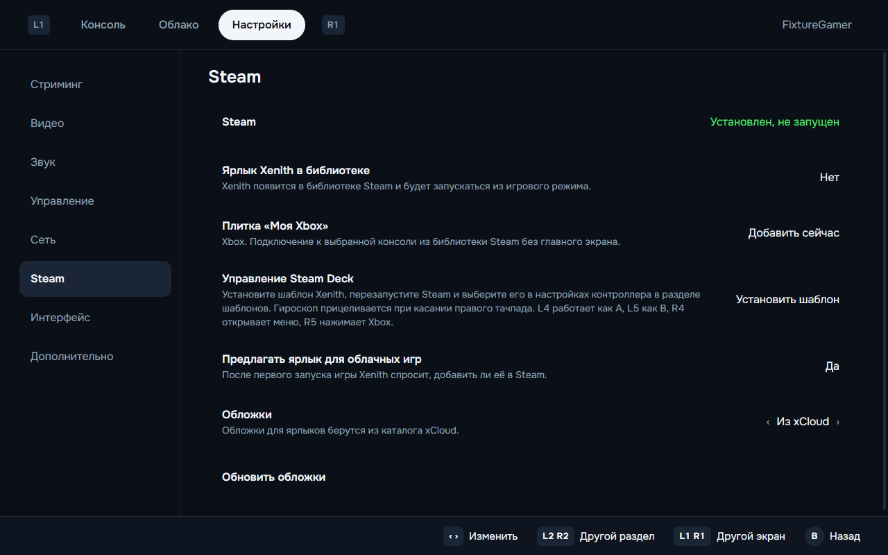

<p align="center">
  
</p>

<h1 align="center">Xenith</h1>

<p align="center">
  Открытый клиент Xbox Remote Play и Xbox Cloud Gaming для Windows 11 и Steam Deck.<br>
  Русский и английский интерфейс, управление геймпадом, честная статистика потока.
</p>

<p align="center">
  <b>Русский</b> · <a href="README.md">English</a>
</p>


## Что умеет

- **Remote Play со своей Xbox.** Находит консоль в аккаунте, будит её из режима ожидания и подключается одной кнопкой. Поддерживает стриминг до 1440p. В настройках доступны Auto, 1440p, 1080p и 720p.
- **Облачные игры Game Pass Ultimate.** Библиотека с поиском, подборками, русскими названиями и обложками, очередь на сервер с оценкой времени.
- **Честные цифры.** Счётчик показывает реальное разрешение входящего кадра, битрейт, задержку сети, буфер, время декодирования и потери. Если консоль отдаёт 1080p, Xenith не напишет «1440p».
- **Профили.** «Минимальная задержка» (буфер видео около 3 мс), «Качество изображения» (сглаживающий буфер и чёткость), «Экономия батареи» для Steam Deck.
- **Картинка.** Повышение чёткости (CAS), масштабирование FSR 1.0, яркость, контраст, насыщенность, режимы заполнения экрана. Всё отключается.
- **Управление.** Навигация геймпадом по всему приложению. View + Menu: короткое нажатие — кнопка Xbox, удержание — меню Xenith. Мёртвая зона, вибрация и вибрация курков, мышь и клавиатура.
- **Steam.** Ярлык Xenith и ярлыки облачных игр в библиотеке Steam с обложками, запуск из игрового режима Steam Deck.
- **Flydigi и X-Haptics.** Диагностика контроллера, Flydigi Space Station и игрового звука, режим «Мост контроллера»: картинка на телевизоре от Xbox, а ПК передаёт ввод и звук для X-Haptics.
- **Надёжность.** Автоматическое переподключение после обрыва (картинка возвращается примерно за 9 секунд), токены в защищённом хранилище ОС, никаких токенов в логах.

## Скриншоты

| Подключение | Во время игры |
|---|---|
|  |  |

| Настройки стриминга | X-Haptics |
|---|---|
|  |  |

| Облако | Вход по коду |
|---|---|
|  |  |

**Steam Deck**

| Главный экран | Меню во время игры |
|---|---|
|  |  |

| Интеграция со Steam | Интеграция со Steam на Deck |
|---|---|
|  |  |

Скриншоты сделаны на демонстрационных данных, поэтому вместо обложек игр — заглушки. Макеты интерфейса лежат в [docs/design](docs/design).

## Установка

### Windows 11

1. Скачайте `Xenith-Setup-<версия>.exe` со страницы [Releases](../../releases) (или портативный `Xenith-<версия>-win-x64.zip`).
2. Запустите установщик. Права администратора не нужны, приложение ставится для текущего пользователя.
3. Сборка пока не подписана, поэтому Windows SmartScreen один раз спросит: «Подробнее» → «Выполнить в любом случае».

### Steam Deck (SteamOS)

Нативная Linux-сборка, без Proton. Подробно: [docs/platform/steam-deck.md](docs/platform/steam-deck.md).

1. В режиме рабочего стола скачайте `Xenith-<версия>-x86_64.AppImage`, в свойствах файла разрешите запуск.
2. Добавьте его в Steam: «Добавить стороннюю игру» или кнопкой «Добавить в Steam» в настройках Xenith. Proton для ярлыка не включайте.
3. Steam Input оставьте включённым с шаблоном «Геймпад»: тогда кнопки Deck видны как обычный Xbox-контроллер.

### macOS

Конфигурация сборки есть (dmg и zip для Intel и Apple Silicon), собирается в GitHub Actions. Сборка не подписана и пока не проверялась на реальном Mac.

## Первый запуск

1. Нажмите «Войти». Откройте [microsoft.com/link](https://www.microsoft.com/link) на телефоне или компьютере, введите код из Xenith и войдите в аккаунт, к которому привязана Xbox. Пароль вводится на сайте Microsoft, Xenith его не видит.
2. На Xbox включите удалённые функции: «Настройки» → «Устройства и подключения» → «Удалённые функции».
3. Нажмите «Подключиться».

## Управление во время игры

| Действие | Геймпад | Клавиатура и мышь |
|---|---|---|
| Меню Xenith | Удерживать View + Menu ~0,6 с | Esc или F1, кнопка «Меню» в углу при движении мыши |
| Кнопка Xbox | Коротко нажать View + Menu | F2 или «Нажать кнопку Xbox» в меню |
| Полный экран | — | F11 или F10 |
| Отключиться | Меню → «Отключиться» | Меню → «Отключиться» |

## Аргументы запуска

| Аргумент | Что делает |
|---|---|
| `--xhome` | Сразу подключиться к последней консоли |
| `--xhome=<serverId>` | Подключиться к конкретной консоли |
| `--xcloud=<titleId>` | Сразу запустить облачную игру (так работают ярлыки облачных игр в Steam) |

## Интеграция со Steam Deck

### Плитка «Моя Xbox»

Войдите в аккаунт и выберите консоль на главном экране. Откройте «Настройки» > Steam и нажмите «Добавить сейчас» рядом с плиткой «Моя Xbox». Перезапустите Steam. Плитка подключается прямо к выбранной консоли через `--xhome=<serverId>`. Для каждой консоли можно добавить отдельную плитку. Повторное добавление обновляет существующий ярлык.

### Гироскоп и задние кнопки

В «Настройки» > Steam нажмите «Установить шаблон» в строке «Управление Steam Deck». Перезапустите Steam. Откройте настройки контроллера ярлыка Xenith или Xbox, выберите текущую раскладку и в разделе шаблонов примените «Xenith - Gyro and back buttons». Установка шаблона не заменяет выбранную раскладку.

| Управление | Действие |
|---|---|
| Гироскоп, пока нажат левый курок | Прицеливание правым стиком |
| L4 / R4 | Нажатие левого / правого стика |
| L5 / R5 | Кнопки Xbox X / Y |
| Правый тачпад | Мышь, нажатие — левая кнопка мыши |
| Нажатие левого тачпада | Правая кнопка мыши |

Меню Xenith по-прежнему открывается удержанием View + Menu, кнопка Xbox — коротким нажатием View + Menu.

Чувствительность и условие включения гироскопа настраиваются в Steam Input. Гироскоп эмулирует стик, поэтому на прицеливание влияют чувствительность и мёртвая зона стика в игре. Для отдельных ярлыков облачных игр можно выбрать разные раскладки Steam. Remote Play пока не определяет игру, запущенную на консоли.

### Сон и переподключение

При переходе Deck в сон во время сессии Xenith запоминает консоль или облачную игру и останавливает локальный стрим. После пробуждения приложение ждёт восстановления сети и пробует подключиться к той же цели. Отключение вручную или выход из аккаунта отменяет восстановление.

Сон Deck не гарантирует паузу игры на удалённом устройстве. Облачная сессия может истечь. Тогда переподключение начнёт новую сессию или поставит её в очередь.

### Клавиатура поиска

В игровом режиме фокус на поле поиска облачных игр или кнопка Y запрашивает экранную клавиатуру Steam. Если она не появилась, нажмите Steam + X. Это работает для поиска Xenith и не определяет текстовые поля внутри видеопотока игры.

### Размер картинки на экране Deck

Видео Xbox имеет формат 16:9, а экран Deck имеет формат 16:10. Во время стрима откройте меню Xenith и измените «Размер картинки» кнопками влево/вправо или A. Режим применяется сразу, в том числе с чёткостью CAS или масштабированием FSR.

| Режим | Результат на экране Deck 1280 x 800 |
|---|---|
| Целиком | Сохраняет весь кадр и пропорции. Для потока 16:9 сверху и снизу остаются полосы по 40 пикселей |
| Заполнить | Заполняет экран и обрезает примерно по 5% с каждой стороны. Элементы интерфейса игры у краёв могут пропасть |
| Растянуть | Заполняет экран без обрезки, растягивая картинку по вертикали примерно на 11% |

По умолчанию выбран режим «Целиком». Xenith запоминает выбор отдельно для каждой облачной игры и восстанавливает его при следующем подключении. Настройки других игр сохраняются. Для Remote Play этот переключатель меняет общую настройку картинки. Режимы не меняют разрешение потока и не добавляют обзора в игре.

Логика ярлыков и восстановления покрыта автоматическими проверками. Выбор шаблона, работа гироскопа, показ клавиатуры и восстановление после настоящего сна Deck ещё требуют проверки на устройстве.

## Что измерено на реальном оборудовании

Xbox Series X в локальной сети, ПК с Radeon RX 9070 XT. Полный журнал: [docs/TESTLOG.md](docs/TESTLOG.md).

| Показатель | Значение |
|---|---|
| Разрешение и частота | 1920×1080, 60 к/с |
| Кодек | H.264 Main 4.2 (консоль не предлагает High и HEVC) |
| Битрейт | 16–18 Мбит/с |
| Декодирование | 0,3–0,4 мс на кадр, аппаратное |
| Буфер видео | 2,6–2,8 мс («Минимальная задержка»), ~23 мс («Качество») |
| От «Подключиться» до картинки | 7–10 с (консоль включена), ~19 с (из режима ожидания) |
| Переподключение после обрыва | ~9 с |
| 10 минут стрима | 0 потерь, память стабильна |

## Честные ограничения

- **Разрешение.** Xenith поддерживает стриминг в 1440p. Замеры выше сделаны на потоке 1080p и не описывают максимальное разрешение программы. Статистика показывает разрешение, которое приложение получает в текущей сессии.
- **Битрейт выше ~18 Мбит/с** консоль не даёт: запросы на повышение она игнорирует. Ограничение битрейта вниз работает.
- **Облако через VPN.** Если облачный трафик уходит в VPN-туннель, соединение может устанавливаться без видео. Исключите Xenith или серверы Xbox Cloud из туннеля.
- **Flydigi Apex 6 Pro и X-Haptics** пока не проверены с реальным контроллером.
- **Steam Deck**: запуск из игрового режима проверен на Steam Deck OLED; стрим и VA-API на Deck ещё не измерены. Ярлык из Steam запускает Xenith через `~/.local/share/xenith/steam-launch.sh` (обход ошибки GPU-процесса Chromium при запуске клиентом Steam).

## Сборка из исходников

Нужны Node.js 22+ и Git.

```bash
npm install
node build.mjs          # main, preload и интерфейс → dist/
npx electron .          # запуск
npx tsc --noEmit        # проверка типов
npx electron-builder --win nsis zip     # установщик Windows
```

Тесты:

```bash
node tools/core-test/run.mjs            # ядро: настройки, история, сессии, ICE
node tools/platform-test/run-tests.mjs  # Steam VDF, appid, Deck, Flydigi
node tools/stream-test/run-input-test.mjs  # ввод: комбинации, Guide, вибрация
```

В сеансе рабочего стола можно проверить ярлыки, обложки и установку шаблона в отдельном временном каталоге Steam. Эта проверка не меняет вашу библиотеку.

```bash
node tools/platform-test/run-steam-smoke.mjs
```

Проверка переключения размеров картинки на настоящем FSR WebGL использует локальный тестовый видеопоток.

```bash
node tools/ui-preview/check-fsr.mjs
```

Linux и macOS собираются в GitHub Actions: [.github/workflows/build.yml](.github/workflows/build.yml).

## Как устроено

- **Electron** (Chromium WebRTC): аппаратное декодирование и геймпады из коробки, одна кодовая база для Windows, SteamOS и macOS. Почему не Tauri и не нативный клиент: [docs/adr/0001-stack-electron.md](docs/adr/0001-stack-electron.md).
- `src/main` — вход в Microsoft и Xbox Live, REST-API сессий xHome и xCloud, каталог Game Pass, настройки, история, журналы.
- `src/main/platform` — режимы GPU, VA-API, Steam Deck, ярлыки Steam, диагностика Flydigi.
- `src/renderer` — интерфейс на React, навигация геймпадом, русский и английский.
- `src/renderer/stream` — стрим-движок: WebRTC, статистика, профили, чёткость, ввод, переподключение.
- `src/shared` — общий контракт между частями.

## Участие в разработке

При правках проекта обновляйте README. Файлы [AGENTS.md](AGENTS.md) и [CLAUDE.md](CLAUDE.md) должны быть одинаковыми. CI проверяет их содержимое командой `node tools/check-agent-docs.mjs`.

## Благодарности и лицензия

Xenith распространяется под лицензией MIT. Знания о протоколе взяты из открытых проектов под MIT:
[Greenlight](https://github.com/unknownskl/greenlight) и [xbox-xcloud-player](https://github.com/unknownskl/xbox-xcloud-player) (unknownskl),
[XStreaming-desktop](https://github.com/Geocld/XStreaming-desktop) и [xstreaming-player](https://github.com/Geocld/XStreaming-player) (Geocld; плеер включён в `vendor/` с нашими исправлениями),
[better-xcloud](https://github.com/redphx/better-xcloud) (redphx).

Xenith не связан с Microsoft и Xbox. Xbox — торговая марка Microsoft.
